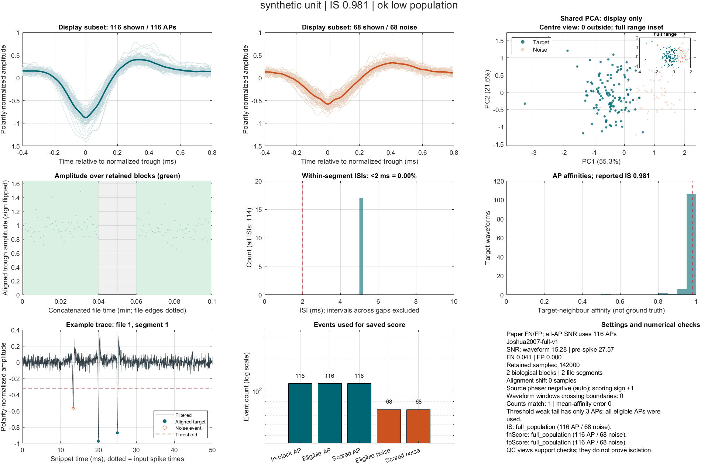

# Isolation Quality of Neurons After Spike Sorting

[](https://github.com/NirvikNU/isolation_score/actions/workflows/matlab.yml)
[](LICENSE)

Assess how well a sorted neuronal unit is separated from background activity
in extracellular recordings. This MATLAB package calculates isolation score
(IS) using the approach of
[Joshua, Elias, Levine & Bergman (2007)](https://doi.org/10.1016/j.jneumeth.2007.03.012),
alongside false-negative and false-positive classifier scores, two
signal-to-noise measures, and diagnostic plots.

Supply a raw recording with sorted spike times and stable recording intervals,
or provide prepared spike and noise waveforms. Use the scores together with
waveform, stability and interspike-interval plots to evaluate unit quality.
See [Methods](docs/methods.md) for calculation definitions and interpretation.

## Start in one minute

Download this repository or clone it, open MATLAB, and add **only its root** to
the path. Do not use `genpath`: the internal functions are intentionally private.

```matlab
addpath('/path/to/isolation_score');
recording = isolation.demoData;  % Synthetic data; no download required.
options = struct('Backend','matlab','CaptureQC',true);
[result, diagnostics] = isolation.score(recording, options);
disp(result)
isolation.plotUnit(diagnostics);
```

Run [examples/quickstart.m](examples/quickstart.m) for the complete example.



## Bring your own recording

```matlab
recording = struct;
recording.Signal = rawChannel;                  % One unfiltered channel.
recording.SampleRateHz = 30000;
recording.SpikeSamples = sortedSpikeIndices;    % Unique, one-based integers.
recording.StableIntervals = [30001 900000; 1200001 1800000];
recording.FileBounds = [1 numel(rawChannel)];    % Or one row per source file.
recording.ID = "session-A/unit-12";
[result, diagnostics] = isolation.score(recording);
```

Intervals are **inclusive sample coordinates in the original signal**. Do not
remove unstable samples before calling the function. Consecutive stable trials
should be represented by one interval from the first trial's start to the last
trial's end, including intertrial data. Keep gaps between stable runs. File
boundaries prevent filtering or waveform extraction across acquisition joins.

Read the [input contract](docs/data-format.md) before adapting your data.
You provide the loader; no particular sorter, acquisition system, session
table, timestamp unit or file naming scheme is assumed.

## Choose an entry point

| Function | Use |
| --- | --- |
| `isolation.score(recording, options)` | Raw channel, target spikes and stable intervals; all five metrics |
| `isolation.scoreWaveforms(ap, noise, options)` | Already-prepared waveform matrices; IS, FN, FP and waveform SNR |
| `isolation.batch(jobs, options)` | Multiple units/sessions with lazy loading, progress and resume |
| `isolation.plotUnit(diagnostics)` | Selected unit's saved diagnostics; requires `CaptureQC=true` |
| `isolation.plotSummary(results)` | Summary of exactly the result cells you supply |
| `isolation.defaults(overrides)` | Inspect or validate calculation settings |

Prepared waveforms must use identical preprocessing and coordinate grids for
AP and noise. That interface does not create a noise population or supply a
pre-spike baseline. See [examples/waveforms_example.m](examples/waveforms_example.m).

## Multiple units, sessions and plotting

```matlab
jobs(1) = struct('ID',"session-A/unit-1", ...
    'Load',@()loadMyUnit("session-A",1),'CaptureQC',true);
jobs(2) = struct('ID',"session-B/unit-2", ...
    'Load',@()loadMyUnit("session-B",2),'CaptureQC',false);
% Your loadMyUnit function returns the recording struct described above.
[results, diagnostics] = isolation.batch(jobs);
isolation.plotUnit(diagnostics{1});
isolation.plotSummary(results,'All selected sessions');
save('results.mat','results','diagnostics');
```

Unit and summary plots are independent. Capture diagnostics only for units you
want to inspect. To inspect the highest/lowest IS after a batch, identify their
indices in `results`, then call `isolation.score` for those recordings with
`CaptureQC=true`; this explicitly recomputes those selected units. Saved QC can
be replotted without computation. Summaries include exactly the result cells
you supply, allowing you to group units by session or across sessions.

For resume, attach `jobs(k).Result = results{k}` and optionally
`jobs(k).Diagnostics = diagnostics{k}` before calling `batch` again. Complete
finite values for all five metrics are retained without calling the loader.
NaN/incomplete entries are retried. `options.Recompute=true` overrides resume.
This does not check whether a saved result matches newly changed data/settings;
recompute deliberately after such changes. See [the runnable batch example](examples/batch_example.m).

## Requirements and performance

- **MATLAB R2024a** is the tested baseline. Raw scoring requires Signal Processing
  Toolbox (`buttord`, `butter`, `filtfilt`); prepared-waveform scoring uses base
  MATLAB. GNU Octave is not tested.
- Small datasets run in MATLAB without a GPU or a compiler. The default `auto`
  backend switches large jobs to the optional native backend. Without a usable
  native installation, large jobs stop with an explicit error.
- Native acceleration currently supports **64-bit Windows, an AVX2 CPU, 144
  waveform coordinates, K=31, and an NVIDIA CUDA GPU**. It combines CPU FN/FP
  with GPU IS. Build from source using [native/README.md](native/README.md).
  The build instructions list the compiler and toolkit requirements.
- For large recordings, pair calculations are processed in blocks and native
  IS streams noise tiles through the GPU. Configure memory and disk limits
  for your machine.
  `DisplayEvents` affects stored plotting subsets only.
- Native IS defaults to mixed precision; use `ISPrecision='double'` for FP64
  affinity arithmetic. The precision is recorded in the result metadata.

See [options and resource limits](docs/options.md). No Parallel Computing
Toolbox is required. Runtime depends strongly on populations and hardware;
batch ETA is a rough average of completed jobs, not a completion guarantee.

## Results and diagnostics

| Field | Meaning |
| --- | --- |
| `IS` | Mean target affinity to other target events, on a 0–1 scale |
| `fnScore` | `Nfn / (Nfn + Ns)`; classifier estimate defined in the paper |
| `fpScore` | `Nfp / Ns`; classifier estimate defined in the paper |
| `snrAP` | Mean AP peak-to-peak amplitude / pooled waveform residual SD |
| `snrBeforeAp` | Same amplitude / pre-spike baseline SD; NaN for waveform-only input |
| `NumAPs`, `NumNoise` | Numbers of target spikes and noise events used |
| `Status` | Calculation outcome; inspect before interpreting any metric |
| `MetricStatistics` | Population counts, low-population flags, backend and precision |
| `MetricVersion` | Calculation definition: `Joshua2007-full-v1` |

`ok_low_population` flags a result supported by few spike or noise events.
Undefined metrics are reported as NaN. The SNR definitions, noise-detection
threshold and other interpretation details are described in
[Methods](docs/methods.md) and [Troubleshooting](docs/troubleshooting.md).

The unit figure shows target/noise waveforms, joint PCA for display, amplitude
over retained time blocks, within-segment ISIs, AP affinities, a thresholded
trace, population counts, and consistency checks. Green time spans are retained
stable blocks; gray spans are excluded; dotted lines mark file boundaries.
The spike and noise waveform panels share the same amplitude scale for direct
visual comparison.

## Test and contribute

```matlab
addpath(pwd);
results = runtests('tests/portable');
assertSuccess(results);
% After building native code and setting CUDA_PATH:
results = runtests('tests/native');
assertSuccess(results);
```

Tests use only generated data and include exhaustive metric references, rare
noise populations, ties, polarity inversion, stable gaps, file joins, resume,
and plots. See [validation](docs/validation.md) and [contributing](CONTRIBUTING.md).

## Citation and license

Please cite the methodological source when using these measures:

Joshua M, Elias S, Levine O, Bergman H (2007). Quantifying the isolation quality
of extracellularly recorded action potentials. *Journal of Neuroscience Methods*
163(2):267–282. [doi:10.1016/j.jneumeth.2007.03.012](https://doi.org/10.1016/j.jneumeth.2007.03.012).

Also record this repository's release/commit, options and backend in your
analysis. [CITATION.cff](CITATION.cff) provides citation metadata.

Released under the [MIT License](LICENSE). Maintained by Nirvik Sinha.
This is an independent implementation of the cited method.
